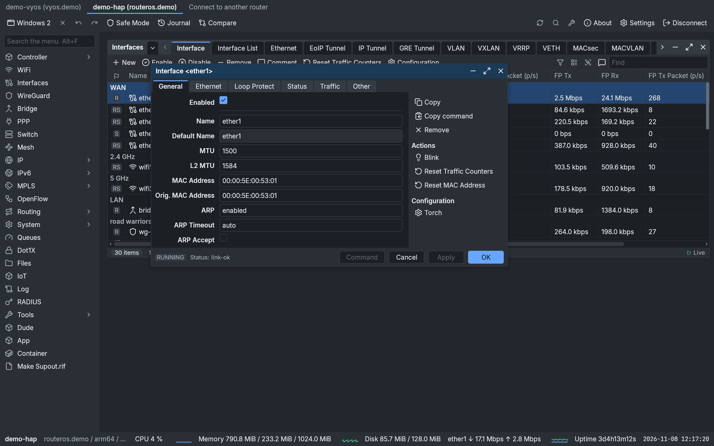
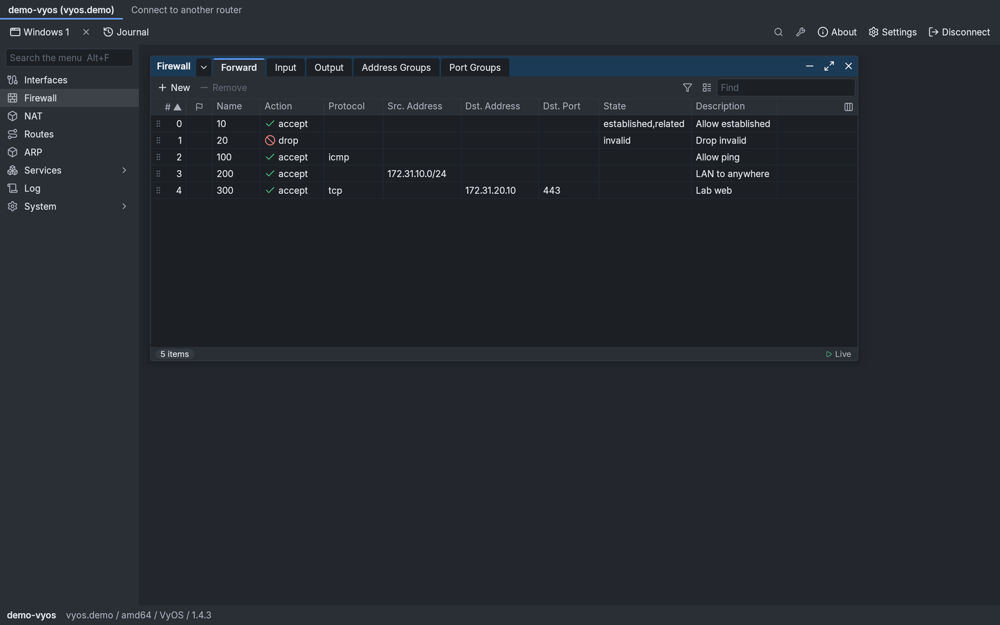
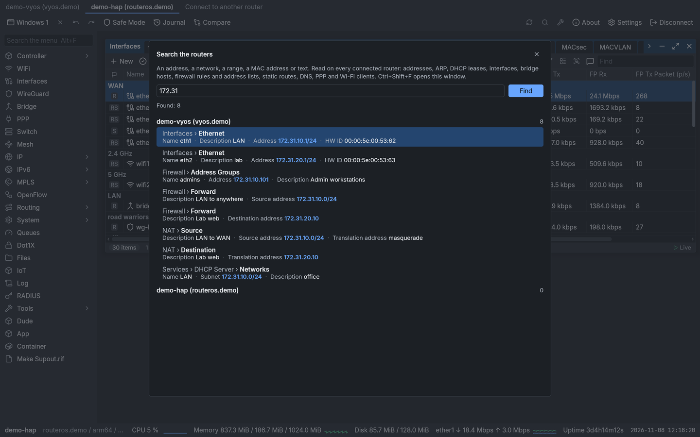
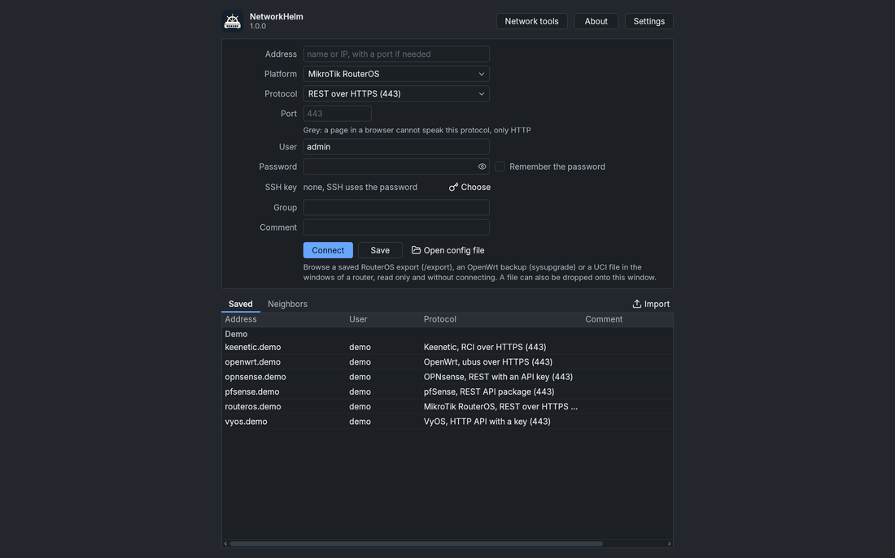
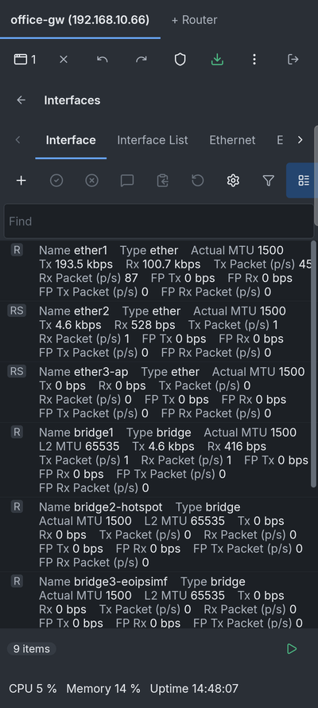

# NetworkHelm

Программа для управления роутерами. Сделана по образцу WinBox: слева дерево меню, справа окна с вкладками, таблицы обновляются на глазах. Работает в Windows, macOS, Linux, Android и в браузере, а роутеры понимает не только MikroTik: ещё OpenWrt, OPNsense, pfSense и VyOS. Проект независимый, к MikroTik и другим производителям отношения не имеет.

Проверял я его в основном на виртуальных роутерах (в таблице ниже написано, на каких именно), так что на живом железе возможны сюрпризы. Если что-то не открылось или неудобно, напишите в [Issues](https://github.com/vasmarfas/networkhelm/issues).

**English:** [README.md](README.md) · **Чат в Telegram:** [@vasmarfas_chat](https://t.me/vasmarfas_chat)

## С какими роутерами работает

| Роутер | Что можно делать | Проверено |
| --- | --- | --- |
| MikroTik RouterOS 7 | смотреть и менять | на виртуальных роутерах CHR: свежий, 7.25 и 7.17.2 |
| MikroTik RouterOS 6 | смотреть и менять | на CHR 6.49.23 и 6.42.12 |
| OpenWrt | смотреть и менять | 25.12 и 24.10 в виртуальных машинах, Wi-Fi-роутер на 25.12 |
| OPNsense | смотреть и менять | 24.7 и 26.7 в виртуальных машинах |
| pfSense | смотреть и менять | CE 2.7.2 в виртуальной машине |
| VyOS 1.4 и новее | смотреть и менять | rolling 2026.10.23 в виртуальной машине |
| Teltonika RutOS | как OpenWrt, плюс окно LTE | не проверено |
| Keenetic, Netcraze | только смотреть | не проверено |
| Linux по SSH | только смотреть | на виртуальных машинах OpenWrt |
| SNMP | обойти агента и найти, что у него есть (группа окон «MIB» с именами из стандартных MIB), смотреть, менять любое записываемое значение, создавать и удалять строки таблиц с RowStatus | чтение на Wi-Fi-роутере, обход и запись на net-snmp в виртуальной машине |
| UPnP, TR-064 | только смотреть | UPnP на Wi-Fi-роутере, TR-064 не проверено |

«Не проверено» значит, что драйвер прошёл тесты на ответах, которые я составил по описанию производителя, а живого устройства у меня не было. Если оно есть у вас, расскажите, как всё прошло: [SUPPORT.md](SUPPORT.md).

К MikroTik программа подключается по порту WinBox 8291 (его она пробует первым, если порт отвечает), по API (с шифрованием и без), REST и SSH, а к роутеру без IP-адреса ещё и по MAC-адресу. Что из этого включить на самом роутере, написано в [руководстве](GUIDE.ru.md).

## Что умеет

- Показывает меню и окна роутера так, как их знают пользователи WinBox: дерево меню с поиском (Alt+F), окна с вкладками, диалоги с кнопками «Применить» и OK. Вкладки, порядок и подписи полей, колонки таблиц программа берёт у самого роутера, поэтому разделы новой версии RouterOS появляются без обновления программы.
- Обновляет таблицы на лету. Строки можно фильтровать, сортировать, выбирать колонки, а выделенные скопировать готовыми командами `add`, текстом, CSV или JSON.
- Перед нажатием «Применить» показывает команду, которую выполнит правка, подсвечивает значение, которое роутер не примет, и ведёт журнал правок за сеанс.
- Включает Safe Mode везде, где роутер умеет откатить правку при обрыве связи. Где не умеет, прямо об этом предупреждает.
- Открывает терминал по SSH с готовыми командами и файлы роутера по SFTP с просмотром и редактором (подсветка, поиск и замена, запись обратно на роутер). Есть туннели SSH, подключение через другой роутер и ключи из ssh-agent.
- Показывает журнал роутера с цветом по важности и ищет по всем подключённым роутерам сразу: по адресу, сети, MAC-адресу или тексту.
- Открывает сохранённую конфигурацию без роутера (`/export` RouterOS, бэкап OpenWrt или файл UCI) в тех же окнах и сравнивает её с другой.
- Хранит адресную книгу с группами, импортирует CSV и адресную книгу WinBox, экспортирует под мастер-паролем. MikroTik в локальной сети находятся сами (вкладка «Соседи»), подсеть можно просканировать.
- Для RouterOS есть Ping, Traceroute, Torch, Profile, Packet Sniffer и графики трафика. По порту 8291 они открываются родными окнами роутера и обновляются сами.
- Есть сетевые инструменты, которые работают на самом устройстве при любом подключённом роутере: пинг с графиком и поиском MTU пути, трассировка с именами узлов, сканеры портов и сети, DNS-запрос, Whois по RDAP и порту 43, сведения об IP, тест скорости, Wake-on-LAN, калькулятор подсетей с диапазонами, разбиение подсетей, время передачи, справочник портов и поиск производителя по MAC. На странице в браузере остаются те, которым сокеты не нужны.
- Сообщает в панели сверху, что роутер видит новую RouterOS и что на GitHub есть новый выпуск программы (приложения для компьютера и Android смотрят один раз при запуске). Нет ответа — ничего не показывается. Окно Check For Updates меняет канал сразу и показывает список изменений предложенной версии: по порту 8291 текст отдаёт сам роутер, иначе приложения для компьютера и Android спрашивают сервер MikroTik, пока окно открыто (что при этом уходит, сказано в [политике конфиденциальности](privacy-policy.md)).

## Скачать

Всё лежит на странице [релизов](https://github.com/vasmarfas/networkhelm/releases). Описание каждого релиза начинается с таблицы: в строках процессор, в столбцах система. Файлов много, вот что брать:

- Windows: установщик (`windows-setup.exe`), переносной EXE (`windows-portable.exe`) или MSI.
- macOS: DMG для Apple silicon (`macos-arm64`) или для Intel (`macos-x64`).
- Linux: пакет DEB или RPM, либо AppImage.
- Android: APK.
- iOS: пока только проект Xcode в `app/iosApp`. Готового приложения в App Store нет.
- Браузер: https://vasmarfas.github.io/networkhelm/ открывается без установки, роутеры на ней вымышленные. Страница нужна, чтобы посмотреть, как всё выглядит; свои роутеры в браузере открывают через шлюз, об этом ниже.

Переносной EXE ставить не нужно. При первом запуске он один раз распаковывается в `%LOCALAPPDATA%\NetworkHelm\portable\<версия>` (около 200 МБ), дальше стартует оттуда, а настройки хранит в папке `NetworkHelm data` рядом с файлом. AppImage запускается через FUSE и ждёт `fusermount` из пакета `fuse3` или `fuse`; без FUSE его запускают с ключом `--appimage-extract-and-run`.

Файлы с пометкой `legacy` собраны для 64-разрядных Windows 7 SP1 и 8 (на Java 17) и рисуют окна процессором, без видеокарты; файлы с пометкой `arm64` — для Windows и Linux на процессорах ARM. На таком железе я их пока не запускал. Если попробуете, напишите, что получилось.

### Что нужно для запуска

Windows 10 и новее, 64 бита (на старой Windows установщик и переносной EXE останавливаются с сообщением о версии системы), macOS 12 и новее, Linux на x86_64 или arm64 с glibc 2.28 и новее (Debian 10, Ubuntu 20.04, RHEL 8), Android 8.0 и новее, iOS 15 и новее. Windows XP и Vista не поддерживаются, 32-разрядная Windows тоже: у Skiko, библиотеки, которая рисует окна, нет сборки под неё.

В браузере приложение работает как WebAssembly там, где есть WebAssembly GC: Chrome и Edge 119, Firefox 120, Safari 18.2 (на iPhone и iPad это iOS 18.2). В более старых браузерах включается сборка на JavaScript. Она медленнее и требует браузер примерно 2021 года и новее (Chrome 85, Firefox 79, Safari 14.1).

## Первое подключение

1. Запустите программу, откроется окно подключения.
2. Впишите адрес роутера: имя или IP-адрес, порт нужен, только если он нестандартный. Почти сразу программа проверит, какие порты отвечают, определит тип устройства и выберет протокол. Порты, которые не ответили, в списке протоколов серые.
3. Введите логин и пароль от роутера. Галочка «Запомнить пароль» сохранит его в защищённом хранилище системы.
4. Нажмите «Подключиться».

Если подключение идёт по протоколу без шифрования (API на порту 8728, HTTP, SNMP v2c), под полями появится предупреждение, а в главном окне метка «Без шифрования». У MikroTik по ней можно щёлкнуть: откроется окно «Подготовить роутер», которое включает шифрованный API-SSL. Не вышло? В [руководстве](GUIDE.ru.md) есть раздел «Если что-то не получается».

 

## В браузере

Браузер сам не умеет открывать соединения с роутерами, поэтому между ним и роутером стоит небольшая программа, шлюз. Проще всего включить её в приложении на компьютере: «Настройки», «Доступ из браузера…», задать пароль и нажать «Открыть доступ». После этого NetworkHelm открывается в браузере на телефоне, планшете или другом компьютере сети по адресу, который покажет то же окно. Браузер работает со списком роутеров и паролями этого компьютера.

Шлюз можно запустить и отдельно: архивом со своей Java для Windows и Linux, jar-файлом (нужна Java 17 или новее) или контейнером Docker. Роутер OpenWrt умеет отдавать страницу сам, без шлюза, но терминала и файлов в таком варианте нет. Подробности в [руководстве](GUIDE.ru.md); шлюз со всеми параметрами описан в [server/README.ru.md](server/README.ru.md), страница без шлюза в [app/webApp/README.ru.md](app/webApp/README.ru.md).

## Как это устроено

Программа говорит с роутерами через интерфейсы, которые они сами публикуют, и спрашивает у роутера всё, что он умеет рассказать. Поля и варианты значений она берёт через `/console/inspect` в RouterOS 7, OpenAPI в pfSense, формы LuCI в OpenWrt. Раскладку окон RouterOS 7 (вкладки, порядок и подписи полей, колонки списков) она читает из описаний интерфейса, которые роутер отдаёт своим клиентам; где роутер их не даёт, берутся пакеты интерфейса из папки `packs`.

То, что консоль и API не печатают, а WinBox показывает (вкладка Resources, Dashboard контроллера, колонки таблиц только для чтения), приходит из объектной модели порта 8291, если на роутере включён WinBox. Окна, которых нет в консольном меню, открываются через тот же порт, и там же правятся, если они не только для чтения.

Клиент для порта 8291 написан по публичным описаниям протокола. Кода, файлов и записанного трафика WinBox в нём нет.

## Сборка из исходников

JDK Gradle скачивает сам через toolchain: JDK 21 для сборки и JetBrains Runtime для десктопного приложения. Для Android нужен Android SDK, для iOS Mac с Xcode.

| Цель | Команда |
| --- | --- |
| Компьютер | `./gradlew :app:desktopApp:run`, с Compose Hot Reload `./gradlew :app:desktopApp:hotRun --auto` |
| Android | `./gradlew :app:androidApp:assembleDebug` |
| Браузер (Wasm) | `./gradlew :server:run`, затем `https://localhost:8443`: шлюз отдаёт веб-приложение и ходит за него к роутерам |
| Браузер без шлюза | `./gradlew :app:webApp:pagesBundle`: страница для статического хоста вроде GitHub Pages, с демо-роутерами и устройствами, до которых браузер её пускает |
| iOS | один раз `tools/ios/build-ssh.sh`, затем открыть `app/iosApp` в Xcode |

Один код на Kotlin Multiplatform и Compose Multiplatform собирается под все эти системы.

## Приватность, условия, поддержка

Приложение ничего не отправляет разработчику: учётной записи нет, аналитики и отчётов о сбоях тоже. Что оно хранит и где, написано в [privacy-policy.md](privacy-policy.md) (на английском), условия использования в [terms.md](terms.md), как поддержать проект в [SUPPORT.md](SUPPORT.md).

## Лицензия

Исходный код доступен для просмотра (source-available) под [PolyForm Noncommercial License 1.0.0](LICENSE) с дополнениями из [NOTICE.md](NOTICE.md). Личное и другое некоммерческое использование бесплатно, для коммерческого нужна отдельная договорённость. Форк нельзя переименовывать и распространять как отдельный продукт. Pull request приветствуются, форк ради них обычный способ внести вклад; условия вклада и правило чистой комнаты, обязательное для любого вклада, описаны в [NOTICE.md](NOTICE.md). Сторонние компоненты перечислены в [THIRD-PARTY-NOTICES.md](THIRD-PARTY-NOTICES.md).

## Товарные знаки

MikroTik, RouterOS, WinBox и RouterBOARD — товарные знаки SIA Mikrotīkls. OpenWrt — зарегистрированный товарный знак Software Freedom Conservancy. OPNsense, pfSense, VyOS, Keenetic, Netcraze, Teltonika и FRITZ!Box принадлежат своим владельцам. NetworkHelm — независимый проект: никто из них с ним не связан, его не одобрял и не спонсирует.
